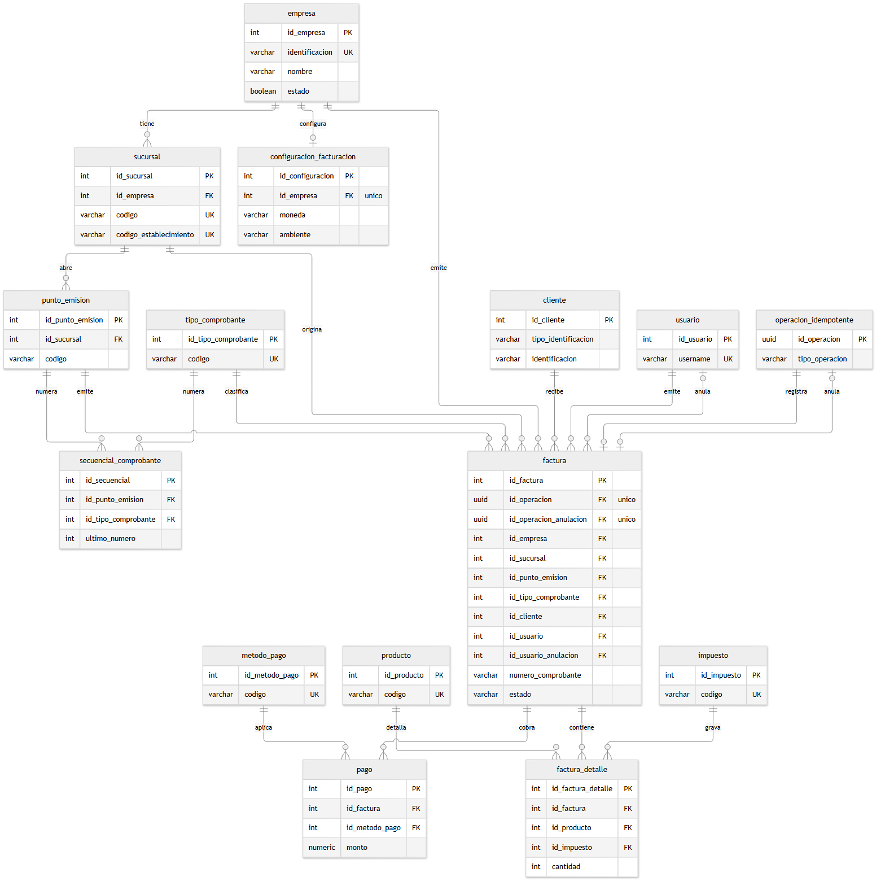
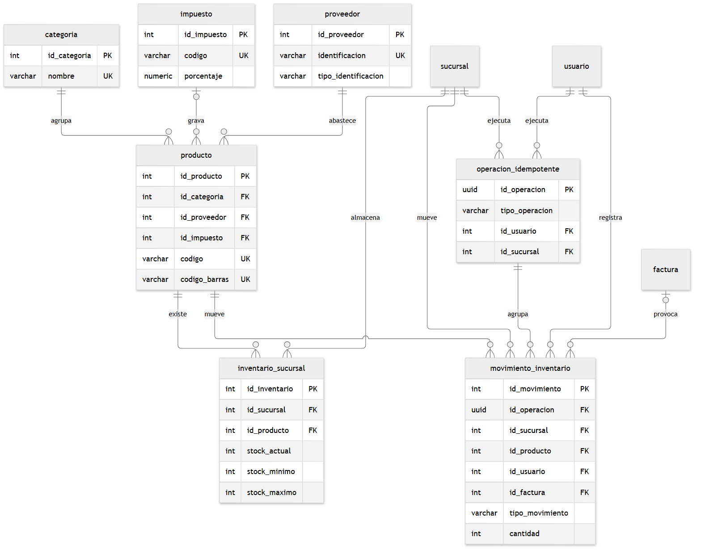
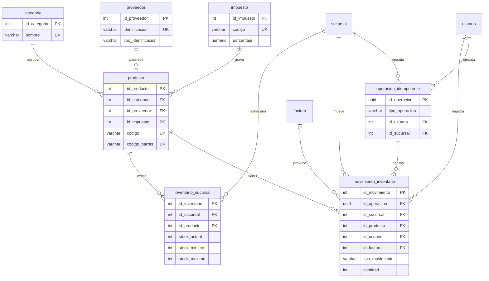
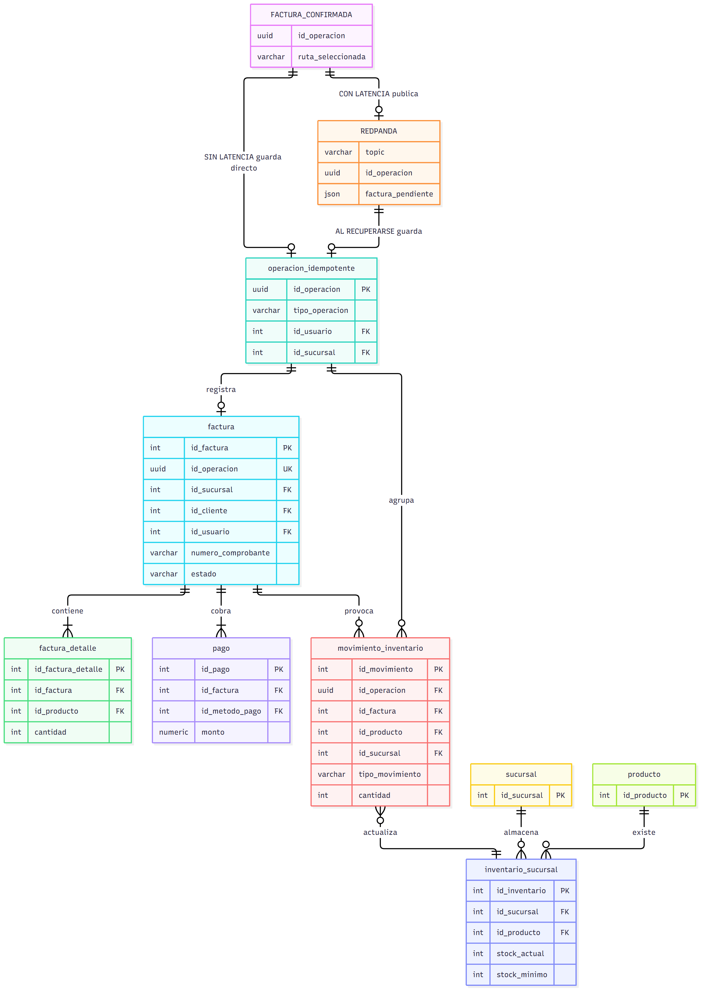
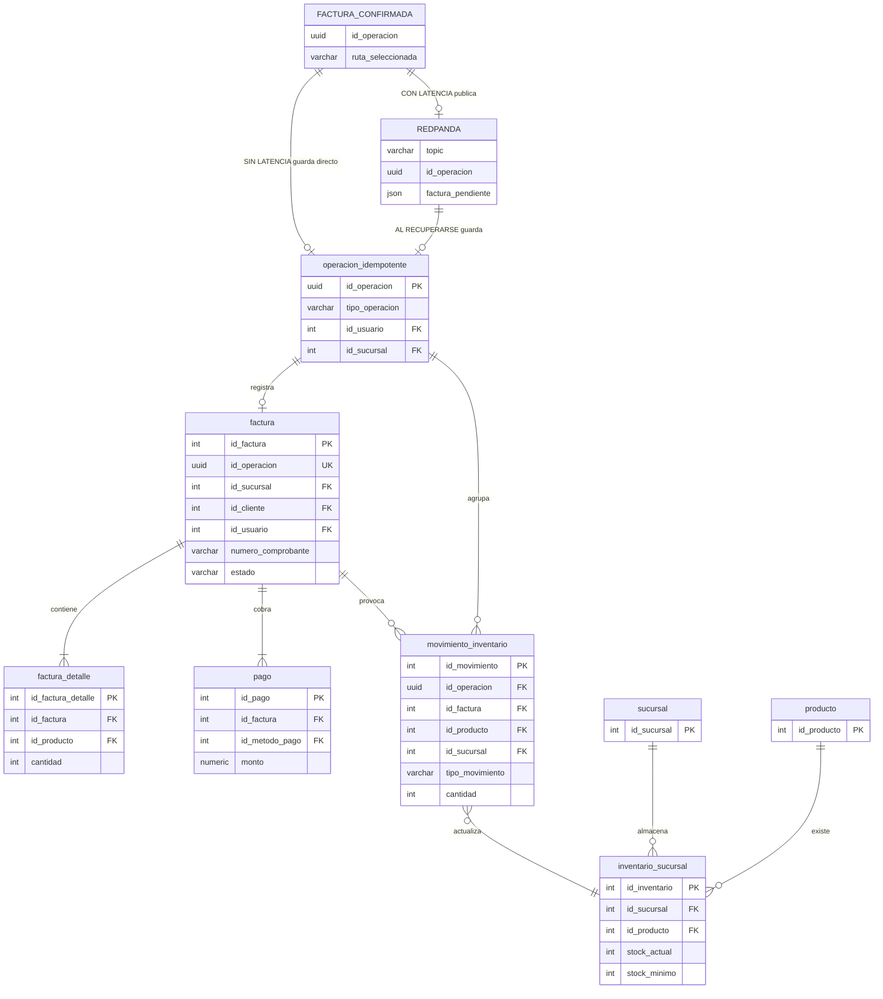
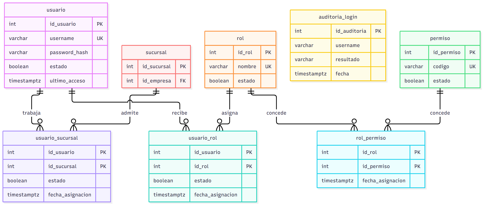
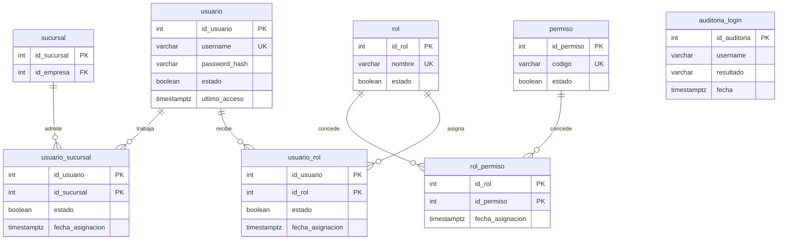

# Modelo entidad-relación de AWR

Esquema `public` de PostgreSQL. Hay 28 tablas. Las líneas representan solo claves foráneas existentes.

Notación:

- `||` exactamente uno
- `o|` cero o uno
- `o{` cero o muchos

## Organización y facturación



```mermaid
erDiagram
    empresa ||--o{ sucursal : tiene
    empresa ||--o| configuracion_facturacion : configura
    empresa ||--o{ factura : emite
    sucursal ||--o{ punto_emision : abre
    sucursal ||--o{ factura : origina
    punto_emision ||--o{ factura : emite
    punto_emision ||--o{ secuencial_comprobante : numera
    tipo_comprobante ||--o{ secuencial_comprobante : numera
    tipo_comprobante ||--o{ factura : clasifica
    cliente ||--o{ factura : recibe
    usuario ||--o{ factura : emite
    usuario |o--o{ factura : anula
    operacion_idempotente ||--o| factura : registra
    operacion_idempotente |o--o| factura : anula
    factura ||--o{ factura_detalle : contiene
    factura ||--o{ pago : cobra
    metodo_pago ||--o{ pago : aplica
    producto ||--o{ factura_detalle : detalla
    impuesto ||--o{ factura_detalle : grava

    empresa {
        int id_empresa PK
        varchar identificacion UK
        varchar nombre
        boolean estado
    }
    sucursal {
        int id_sucursal PK
        int id_empresa FK
        varchar codigo UK
        varchar codigo_establecimiento UK
    }
    configuracion_facturacion {
        int id_configuracion PK
        int id_empresa FK UK
        varchar moneda
        varchar ambiente
    }
    punto_emision {
        int id_punto_emision PK
        int id_sucursal FK
        varchar codigo
    }
    tipo_comprobante {
        int id_tipo_comprobante PK
        varchar codigo UK
    }
    secuencial_comprobante {
        int id_secuencial PK
        int id_punto_emision FK
        int id_tipo_comprobante FK
        int ultimo_numero
    }
    cliente {
        int id_cliente PK
        varchar tipo_identificacion
        varchar identificacion
    }
    factura {
        int id_factura PK
        uuid id_operacion FK UK
        uuid id_operacion_anulacion FK UK
        int id_empresa FK
        int id_sucursal FK
        int id_punto_emision FK
        int id_tipo_comprobante FK
        int id_cliente FK
        int id_usuario FK
        int id_usuario_anulacion FK
        varchar numero_comprobante
        varchar estado
    }
    factura_detalle {
        int id_factura_detalle PK
        int id_factura FK
        int id_producto FK
        int id_impuesto FK
        int cantidad
    }
    pago {
        int id_pago PK
        int id_factura FK
        int id_metodo_pago FK
        numeric monto
    }
    metodo_pago {
        int id_metodo_pago PK
        varchar codigo UK
    }
```

`secuencial_comprobante` admite una sola fila por cada par `id_punto_emision` + `id_tipo_comprobante`. `factura` admite un solo `numero_comprobante` por empresa y un solo `secuencial` por punto, tipo y número.

## Inventario y resiliencia





`inventario_sucursal` tiene una fila como máximo por cada par sucursal y producto. `id_factura` en el movimiento puede quedar vacío. `id_impuesto` en `producto` también puede quedar vacío.

## Facturación resiliente

La imagen comienza cuando el usuario confirma una factura y separa claramente sus dos caminos:

- **Sin latencia:** la factura se guarda inmediatamente en PostgreSQL.
- **Con latencia:** la factura entra en Redpanda; cuando la latencia vuelve a ser aceptable, el consumidor la guarda en PostgreSQL.

Los dos caminos llegan a las mismas tablas. `id_operacion` evita guardar dos veces la misma factura. Mientras el mensaje espera en Redpanda todavía no existe una fila en `factura`. El stock se descuenta cuando la factura finalmente se guarda en PostgreSQL.

`FACTURA_CONFIRMADA` representa el evento inicial y Redpanda representa el sistema externo; no son tablas de PostgreSQL. Las demás entidades sí corresponden al modelo transaccional existente.





## Seguridad y roles





`usuario_rol`, `usuario_sucursal` y `rol_permiso` son las tres tablas puente. Un usuario puede tener varios roles y varias sucursales, o ninguno. `auditoria_login` no tiene clave foránea.

## Fuera del modelo de negocio

`knex_migrations` y `knex_migrations_lock` solo registran migraciones y no apuntan a ninguna tabla de AWR.

## Relación probable no confirmada por FK

`auditoria_login.username` coincide con `usuario.username`, pero PostgreSQL no declara esa clave.
